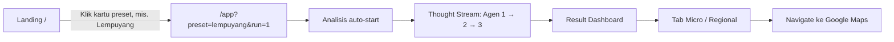

# PRODUCT REQUIREMENTS DOCUMENT (PRD)
## MARGI AI — Vibe-Preserving Crowd Dispersion & Micro-MSME Rerouting Engine

---

## 0. Kontrol Dokumen

| Atribut | Detail |
| :--- | :--- |
| **Produk** | MARGI AI |
| **Dokumen Induk** | [`BRD.md`](../BRD.md) (status `FINAL`) |
| **Dokumen Pasangan** | [`TDD.md`](./TDD.md) (Technical Design Document) |
| **Referensi Desain** | [`DESIGN.md`](../DESIGN.md) (Perk Style Reference — diadaptasi, lihat §10) |
| **Kompetisi** | Bali DigiFest 2026 — AI Web Innovation Challenge (AIWIC) |
| **Rilis Target** | `v1.0-submission` (MVP Tahap 1, 7 hari) → `v2.0-final` |
| **Versi Dokumen** | 1.0 |
| **Status** | `DRAFT — MENUNGGU REVIEW OWNER` |

### 0.1 Ringkasan Keputusan Produk (hasil diskusi)

| # | Keputusan | Dampak ke Produk |
| :--- | :--- | :--- |
| D-01 | **Guest-first**: seluruh fitur inti (analisis, rekomendasi, simulasi) bisa dipakai tanpa login. | Memenuhi syarat *Clean-Start* juri (BRD §8.2.2). |
| D-02 | Login opsional via **Email + Password** (verifikasi email & reset password) dan **Google SSO**. | Login membuka fitur: simpan trip, riwayat analisis (termasuk foto), dashboard admin. |
| D-03 | **Landing page terpisah** (`/`) dan **Analyzer** di `/app`. | Landing wajib punya tombol *Quick Preset* yang langsung menjalankan analisis (maks. 1 klik dari landing). |
| D-04 | UI **bilingual EN/ID** (default EN, toggle ID). Dokumen spesifikasi berbahasa Indonesia. | Semua copy UI & output AI tersedia dalam 2 bahasa. |
| D-05 | Foto yang diunggah **hanya disimpan untuk user login** (riwayat, privat). Guest: diproses *in-memory* lalu dibuang. | Butuh *object storage* privat + kontrol hapus. |
| D-06 | Dataset kurasi **40–60 entitas** (±15 DTW viral/alternatif + ±30 UMKM). | Demo lebih kaya, tetap dikurasi manual. |
| D-07 | Termasuk **Admin Dashboard** (CRUD DTW/UMKM, preset, forecast, re-embed). BR-10 (onboarding UMKM mandiri) & Shareable Trip Card **tetap P1**. | Admin di-*lazy load*, tidak mengganggu performa publik. |
| D-08 | Desain mengikuti DESIGN.md dengan 2 penyesuaian: font **Geist** (pengganti OTSono) & **warna semantik khusus visualisasi data** (skala kepadatan merah→hijau). | Lihat §10. |

---

## 1. Ringkasan Produk

### 1.1 Pernyataan Masalah (ringkas dari BRD §2)
Wisatawan di Bali menumpuk di sedikit titik viral (Lempuyang dengan antrean 60–210 menit, *gridlock* Jl. Raya Ubud 10.00–21.00 WITA, simpul Canggu pukul 16.00). Padahal hanya 1–3 km dari situ, atau di 6 kabupaten penerima subsidi PHR (Bangli, Karangasem, Buleleng, Tabanan, Klungkung daratan, Jembrana), banyak DTW dan UMKM yang suasananya mirip tapi masih sepi. Alat yang ada sekarang (Google Maps, chatbot itinerary) tidak menggabungkan **estetika visual + kepadatan + dampak ekonomi lokal**.

### 1.2 Solusi
Web app berbasis **3 agen AI** yang:
1. **Membaca "vibe" foto referensi** (Vision LLM → 5 dimensi atmosfer → embedding).
2. **Mengecek kepadatan** lokasi asal & kandidat alternatif (*Crowd Friction Score*, fallback 3 tingkat).
3. **Menyusun paket rute pengganti** (Mikro 1–3 km & Regional lintas kabupaten), masing-masing dipasangkan dengan 1–2 UMKM, disertai etika budaya dan *impact badge*.

Seluruh proses penalaran ditampilkan secara transparan (*Glass-Box UI*) secara *real-time*.

> **Pembaruan prototipe (DECISIONS D-025, D-026; disetujui owner 2026-11-03).** Pintu masuk utama kini **peta**: wisatawan menandai titik awalnya, memilih suasana, lalu radar memindai tempat di sekitarnya beserta keramaiannya. Dari tempat yang ramai, MARGI menawarkan alternatif dengan suasana mirip yang lebih sepi, lalu **merencanakan perjalanan di dalam aplikasi** bersama **MARGI Copilot**, asisten AI yang memahami permintaan bebas, memanggil *tools* perhitungan, dan mengusulkan perubahan yang bisa diterapkan dengan satu ketukan. Analisis foto (3 agen di atas) tetap ada sebagai jalur "Cocokkan dari foto" (`/app/photo`).

### 1.3 Positioning Statement
> Untuk **wisatawan yang mengejar estetika tapi tidak punya banyak waktu**, MARGI AI (*Margi* = jalan/rute selaras dalam bahasa Bali/Sanskerta) adalah **mesin rerouting berbasis vibe** yang mencarikan **tempat dengan suasana serupa tapi lebih sepi, ditambah UMKM lokal terdekat**. Bedanya dengan Google Maps atau chatbot AI: MARGI AI **memahami foto, menghitung keramaian, dan sengaja mengarahkan wisatawan ke daerah yang perlu pemerataan ekonomi**.

---

## 2. Tujuan, Non-Tujuan & Metrik Keberhasilan

### 2.1 Tujuan Produk (dipetakan ke BRD §3)

| Kode | Tujuan | Metrik MVP (dapat diukur) | BO |
| :--- | :--- | :--- | :---: |
| G-01 | Pipeline 3 agen AI menjadi inti fungsi (lulus *AI Removal Test*). | p95 waktu analisis end-to-end **≤ 10 detik** (preset ≤ 6 detik); event pertama di stream ≤ 1,5 detik. | BO-01 |
| G-02 | Andal 100% saat diuji juri kapan pun. | 0 *crash* pada 50 kali uji acak (preset + upload + simulasi + jam tengah malam); selalu ada output pada tier fallback mana pun. | BO-02 |
| G-03 | Mengalihkan dari titik jenuh (≥ 75%) ke alternatif lengang (≤ 35%) dengan vibe mirip. | Setiap preset menghasilkan ≥ 2 rekomendasi Mikro dan ≥ 2 Regional dengan `Sim_vibe ≥ 70` (atau ditandai "relaxed"). | BO-03 |
| G-04 | Transparansi AI, kualitas repo, kepatuhan. | Technical Gate `PASS`; `README.md`, `.env.example`, Disclosure lengkap; skor Lighthouse Accessibility ≥ 90. | BO-04 |

### 2.2 Non-Tujuan (MVP)
- Tidak ada pembayaran, *booking*, atau *checkout* (BRD §8.2.1).
- Tidak ada login wajib di depan fitur inti (BRD §8.2.2).
- Tidak ada *scraping* Google Maps (BRD §8.2.3).
- Tidak ada navigasi *turn-by-turn* (diserahkan ke Google Maps lewat *deep link*).
- Tidak ada aplikasi mobile native (cukup web responsif).

### 2.3 North Star & Metrik Pendukung (pasca-lomba)
- **North Star:** jumlah klik "Navigate" ke DTW/UMKM alternatif per minggu (proksi kunjungan yang berhasil dialihkan).
- Pendukung: rasio klik ke UMKM vs DTW, % rekomendasi Regional yang dipilih, total estimasi menit antre yang dihemat.

---

## 3. Persona & Jobs-to-be-Done

| Persona | Job-to-be-Done | Fitur Kunci |
| :--- | :--- | :--- |
| **P1 — Aesthetic & Time-Conscious Traveler** | "Saat saya melihat foto viral, saya ingin menemukan tempat dengan suasana yang sama tanpa antre berjam-jam, supaya liburan singkat saya tidak terbuang." | Upload foto, Vibe Match Breakdown, Regional Option, simpan trip. |
| **P2 — Trapped On-the-Go Tourist** | "Saat saya terjebak macet di Ubud atau Canggu, saya ingin tempat pelarian terdekat (5–10 menit) yang sedang sepi." | Pilih lokasi asal + jam sekarang, Micro Option, tombol Navigate. |
| **P3 — UMKM & Desa Wisata (beneficiary)** | "Saya ingin wisatawan dari titik ramai diarahkan ke usaha saya." | MSME Bundling, Fiscal Equity Boost, (P1: onboarding mandiri). |
| **P4 — Juri AIWIC (evaluator)** | "Dalam waktu singkat, saya ingin memastikan AI-nya benar-benar bekerja dengan input saya sendiri dan pada jam berapa pun." | Clean-Start, Quick Preset, upload bebas, Judge Simulation Toggle, Thought Stream. |
| **P5 — Admin/Kurator (internal)** | "Saya ingin memperbarui data DTW/UMKM dan profil keramaian tanpa menyentuh kode." | Admin Dashboard. |

---

## 4. Ruang Lingkup

### 4.1 Prioritas Fitur

| ID | Fitur | Prioritas | Rilis | Sumber |
| :--- | :--- | :---: | :---: | :---: |
| F-01 | Landing page + Quick Preset Launcher | P0 | v1.0 | BR-01, D-03 |
| F-02 | Analyzer Input (preset, upload foto, lokasi asal, jam WITA) | P0 | v1.0 | BR-01 |
| F-03 | Agen 1 — Multimodal Vibe Deconstruction | P0 | v1.0 | BR-02 |
| F-04 | Agen 2 — Crowd Telemetry + 3-Tier Fallback + CFS | P0 | v1.0 | BR-05 |
| F-05 | Agen 3 — Dual-Radius Rerouting + MSME Bundling + Etika | P0 | v1.0 | BR-03, BR-04, BR-09 |
| F-06 | Judge Stress-Test Simulation Toggle | P0 | v1.0 | BR-06 |
| F-07 | Glass-Box Agentic Thought Stream | P0 | v1.0 | BR-07 |
| F-08 | Dual-Histogram Crowd Visualizer | P0 | v1.0 | BR-08 |
| F-09 | Result Dashboard (Vibe Breakdown, Route Cards, Impact Badge, Peta, Navigate) | P0 | v1.0 | BR-03/04/09 |
| F-10 | Auth: Email + Password (verify & reset) + Google SSO | P0 | v1.0 | D-02 |
| F-11 | Riwayat Analisis & Simpan Trip (user login) | P0 | v1.0 | D-02, D-05 |
| F-12 | Admin Dashboard (DTW/UMKM, Preset, Forecast, Etika, Re-embed) | P0* | v1.0 | D-07 |
| F-13 | Bilingual EN/ID | P0 | v1.0 | D-04 |
| F-14 | Self-Service MSME Onboarding | P1 | v2.0 | BR-10 |
| F-15 | Shareable Trip Card (PNG + public link) | P1 | v2.0 | BR-10 |
| F-16 | Analytics self-hosted (Umami) | P1 | v2.0 | — |
| F-17 | Explore Map: onboarding, titik awal (GPS/manual, koreksi geser peta), filter suasana, radar scan, daftar & detail tempat dengan keramaian per jam dan alternatif lebih sepi | P0 | v1.0 | D-025, BR-11 |
| F-18 | Trip Planner in-app: itinerary ≤ 5 tujuan, jam berangkat + grafik keramaian per jam berangkat, skor perjalanan, koridor macet, rute di peta, ekspor multi-stop ke Google Maps | P0 | v1.0 | D-026, BR-12 |
| F-19 | MARGI Copilot: chat bebas ID/EN dengan *tool calling*, kartu saran yang bisa diterapkan/diurungkan, insight proaktif, jejak penalaran | P0 | v1.0 | D-026, BR-13 |
| F-20 | Rencana tersimpan tanpa login + ringkasan dampak (sebelum/sesudah) | P0 | v1.0 | D-026, D-01 |

> \*F-12 berstatus P0 dengan **scope minimal**: CRUD + re-embed + editor forecast. Kalau waktu mepet, polish UI admin boleh dikorbankan, tapi fungsinya jangan.

### 4.2 Di Luar Lingkup
Lihat §2.2. Ditambah: multi-tenant UMKM, ulasan/rating user, notifikasi push, chat AI umum di luar konteks perjalanan Bali (MARGI Copilot hanya menjawab soal rencana perjalanan, keramaian, macet, dan UMKM; D-026), navigasi belokan-demi-belokan di dalam aplikasi (diserahkan ke Google Maps).

---

## 5. Arsitektur Informasi & Sitemap

```text
/                         Landing (publik, layar penuh)
├── /app                  Explore Map (publik, layar penuh): onboarding → lokasi → suasana → scan → jelajah → detail
│   ├── /app?place=:id    Detail tempat (bisa di-back dengan tombol browser)
│   ├── /app/trip         Trip Planner + MARGI Copilot (layar penuh); ?saved=1 membuka rencana tersimpan
│   ├── /app/photo        Analyzer foto (3 agen) + Result Dashboard
│   └── /app/a/:analysisId  Permalink hasil analisis foto (publik bila guest pemilik / user pemilik)
├── /login                Login (email/password + Google)
├── /register             Registrasi
├── /verify-email         Konfirmasi token verifikasi
├── /forgot-password      Minta reset
├── /reset-password       Set password baru
├── /me                   Akun (butuh login)
│   ├── /me/history       Riwayat analisis
│   └── /me/trips         Trip tersimpan (+ detail /me/trips/:id)
├── /admin                Admin (role ADMIN, lazy-loaded)
│   ├── /admin/venues     DTW & UMKM (list, create, edit, re-embed)
│   ├── /admin/presets    Quick Preset
│   ├── /admin/forecast   Editor kurva forecast 7×24 per venue
│   ├── /admin/etiquette  Basis aturan etika budaya
│   ├── /admin/corridors  Koridor kritis & jendela penalti
│   └── /admin/stats      Statistik analisis & status telemetri
├── /about/ai-disclosure  Halaman AI & Technology Disclosure + Responsible AI
└── /privacy              Kebijakan privasi singkat
```

Navigasi global (top bar): Logo `MARGI AI` · `How it works` · `Analyzer` · `Disclosure` · toggle bahasa `EN | ID` · `Sign in` (ghost) · CTA lime **`Try Analyzer`**.

---

## 6. Alur Pengguna Utama

### 6.0 Flow Utama — Explore → Plan → Copilot (jalur emas demo, D-025/D-026)

```mermaid
flowchart LR
  L["Landing /"] -->|"Pergi sekarang"| O["/app onboarding (sekali)"]
  O --> G["Titik awal: GPS / pilih kota / geser peta"]
  G --> V["Pilih suasana (opsional)"]
  V --> S["Radar scan: tempat + keramaian"]
  S --> D["Detail tempat ramai: alternatif lebih sepi"]
  D -->|"Rencanakan perjalanan"| T["/app/trip: itinerary + skor"]
  T --> C["MARGI Copilot: chat → kartu saran → Terapkan"]
  C --> N["Simpan → ringkasan dampak → navigasi multi-stop"]
```

**Situasi yang didukung:** (1) rencanakan dari tempat yang dipilih, (2) *kejebak macet* (dari titik awal, atau skenario demo berlabel di Jl. Raya Ubud), (3) *sudah punya rencana* (audit urutan, jam, dan tempat tutup).
**Aturan:** tanpa login; GPS di luar Bali ditolak dengan ajakan memilih titik awal; data keramaian selalu berlabel Prakiraan/Langsung/Simulasi; semua angka di kartu saran berasal dari perhitungan kode.

### 6.1 Flow A — Juri / Guest via Quick Preset (analisis foto)

**Aturan:** dari landing ke hasil maksimal **1 klik**; tidak ada modal, cookie wall, atau login yang menghalangi.

### 6.2 Flow B — Custom Upload
1. Di `/app`, user men-*drop* foto (JPEG/PNG/WebP ≤ 5 MB; dikompres di client ke sisi terpanjang 1024 px).
2. Memilih **lokasi asal** (dropdown titik viral/koridor, atau "Use my location" lalu *snap* ke koridor terdekat) dan **jam kedatangan** (default: sekarang, WITA).
3. (Opsional) menyalakan **Judge Simulation Toggle**.
4. Klik **Analyze vibe** → stream → hasil.
5. Jika user login: toggle "Save photo to my history" (default ON, ada keterangan privasi).

### 6.3 Flow C — Simpan Trip
Guest yang klik **Save trip** → modal login/register → setelah login, analisis guest otomatis **di-claim** ke akunnya (tanpa foto, karena foto guest tidak disimpan) → trip tersimpan.

### 6.5 Flow E — Kejebak Macet
Di peta, **Tanya MARGI → Aku kejebak macet**. MARGI mendeteksi koridor yang sedang dalam jendela macet (BRD §1, TDD §5 `Corridor`), lalu menawarkan: singgah di UMKM terdekat sampai jendela macet reda, menggeser jam berangkat, atau menukar tujuan pertama ke tempat bersuasana mirip yang rutenya tidak melewati koridor aktif.

### 6.4 Flow D — Admin
Login sebagai ADMIN → `/admin/venues` → tambah UMKM → isi data & upload foto venue → **Generate Vibe Profile** (Agen 1 dijalankan pada foto venue) → review/edit 5 dimensi → **Save & Embed** → venue langsung jadi kandidat rekomendasi.

---

## 7. Kebutuhan Fungsional Detail

Format: *User Story* → *Acceptance Criteria* (AC, gaya Given/When/Then bila perlu).

### F-01 — Landing Page & Quick Preset Launcher
**Story:** Sebagai juri, saya ingin langsung mencoba studi kasus nyata dari halaman pertama.
- AC-01.1: Bagian hero (lime accent block) menampilkan headline display (mis. *"Same vibe. Without the queue."*), sub-copy 1 kalimat, CTA **Try Analyzer**, dan **4 kartu Quick Preset**: Lempuyang Gates of Heaven, Jl. Raya Ubud, Ubud Monkey Forest, Canggu Junction.
- AC-01.2: Klik kartu preset → navigasi ke `/app?preset={slug}&run=1` dan analisis berjalan otomatis.
- AC-01.3: Section berikutnya: *Problem in numbers* (dark island stats dari BRD §2), *How the 3 agents work*, *Impact for MSMEs & regencies*, *Responsible AI*, dan footer gelap.
- AC-01.4: LCP ≤ 2,5 detik (4G simulasi); animasi GSAP menghormati `prefers-reduced-motion`.
- AC-01.5: Tidak ada popup apa pun saat halaman dimuat.

### F-02 — Analyzer Input
**Story:** Sebagai wisatawan, saya ingin memasukkan foto, lokasi, dan jam dengan cepat.
- AC-02.1: Panel input berisi: grid preset (4), *dropzone* upload, pemilih lokasi asal, pemilih hari & jam (WITA, langkah 1 jam), toggle simulasi, dan CTA lime **Analyze vibe**.
- AC-02.2: Memilih preset otomatis mengisi gambar referensi, lokasi asal, dan jam default preset; user tetap boleh mengubah jam.
- AC-02.3: Validasi upload: tipe JPEG/PNG/WebP/HEIC (HEIC dikonversi di client bila didukung; jika gagal tampilkan pesan), ukuran ≤ 5 MB **setelah** kompresi; pesan error bilingual.
- AC-02.4: Kalau tidak ada foto & tidak ada preset, CTA disabled dengan *helper text*.
- AC-02.5: Jam ditampilkan dengan label zona `WITA (UTC+8)`; jika browser user berada di zona lain, tampilkan konversi jam lokal sebagai teks kecil.
- AC-02.6: "Use my location" opsional (izin geolokasi); koordinat di-*snap* ke koridor/titik asal terdekat dalam radius 5 km. Jika di luar radius, tampilkan "Nearest supported area: …".

### F-03 — Agen 1: Multimodal Vibe Deconstruction (BR-02)
**Story:** Sebagai wisatawan, saya ingin tahu "vibe" apa yang ditangkap AI dari foto saya.
- AC-03.1: Sistem menghasilkan **Vibe Profile** terstruktur dengan 5 dimensi: `topography`, `architecture`, `lighting`, `activity`, `visualDensity`. Tiap dimensi berisi `label`, `descriptors[]` (3–6 kata kunci), dan `intensity` 0–1.
- AC-03.2: Vibe Profile diubah menjadi teks kanonik lalu di-*embed*; dilanjutkan *similarity search* ke database DTW/UMKM.
- AC-03.3: Jika foto **bukan** pemandangan/tempat (selfie close-up, dokumen, meme), AI mengembalikan `isTravelScene=false` → UI menampilkan pesan ramah + saran memakai preset (bukan error 500).
- AC-03.4: Teks yang muncul di dalam gambar **tidak boleh** dianggap sebagai instruksi (mitigasi *prompt injection*).
- AC-03.5: UI menampilkan **Vibe Breakdown**: 5 bar dimensi + chip deskriptor + ringkasan 1 kalimat.

### F-04 — Agen 2: Crowd Telemetry & Bottleneck Evaluator (BR-05)
**Story:** Sebagai wisatawan, saya ingin tahu seberapa ramai tujuan saya dan apakah alternatifnya benar-benar sepi.
- AC-04.1: Kepadatan per venue ditampilkan dalam skala relatif 0–100% (boleh > 100% saat *live surge*), dengan 5 kelas: `Low` (0–20), `Below average` (21–35), `Average` (36–60), `Above average` (61–74), `High` (≥ 75).
- AC-04.2: Sistem menghitung **CFS** (BRD §7.2) untuk lokasi asal dan setiap kandidat, termasuk prediksi +2 jam dan penalti koridor.
- AC-04.3: Lokasi asal dengan `CFS ≥ 75` **atau** `B_eff ≥ 75` ditandai **Red Zone — Reroute recommended**. Jika tidak merah, hasil tetap menampilkan alternatif tetapi dengan banner "Your destination looks comfortable right now — here are similar calm options anyway."
- AC-04.4: Kandidat hanya lolos jika **buka** pada jam kedatangan dan `B_eff ≤ 35`.
- AC-04.5: **3-Tier Fallback** otomatis: `LIVE` → `FORECAST` (cache mingguan 7×24) → `SIMULATION`. Tier yang dipakai **selalu ditampilkan** sebagai badge pada tiap venue (mis. `Live`, `Forecast`, `Simulated`).
- AC-04.6: Menampilkan *Arrival/Departure hours* (jam paling sepi untuk tiba dan pergi) untuk lokasi asal dan alternatif.

### F-05 — Agen 3: Dual-Radius Rerouting, MSME Bundling & Cultural Synthesizer (BR-03/04/09)
**Story:** Sebagai wisatawan, saya ingin dua jenis opsi, dekat dan regional, lengkap dengan tempat makan atau belanja lokal.
- AC-05.1: Output terbagi menjadi 2 tab: **Micro Escape (1–3 km)** dan **Regional Discovery (6 recipient regencies)**, masing-masing maksimal **3** rekomendasi berurutan menurut skor `R` (BRD §7.3).
- AC-05.2: Setiap rekomendasi DTW dipasangkan dengan **1–2 UMKM** (kuliner/kopi/kriya) dalam radius ≤ 3 km dari DTW tersebut, yang juga buka & `B_eff ≤ 35`. Masing-masing disertai alasan kecocokan (≤ 25 kata) dan jam kunjungan terbaik.
- AC-05.3: Setiap kartu menampilkan: foto, nama, kabupaten, jarak dari asal, estimasi waktu tempuh, **Vibe Match %** (+ dimensi paling cocok), badge kepadatan, **Impact Badges** (`Time saved ~X–Y min`, `Fiscal Equity Boost` bila kabupaten penerima/zona penyangga, `Supports N local MSMEs`), dan **Cultural Etiquette** (maks. 3 poin).
- AC-05.4: Aturan etika diambil dari **basis aturan terkurasi** (contoh: kamen/selendang, area suci, cuntaka, jangan memanjat bangunan suci, drone). LLM hanya merangkai, tidak mengarang aturan. Venue bertag `TEMPLE` wajib menampilkan aturan kamen/selendang.
- AC-05.5: Jika kandidat yang lolos ambang (`Sim ≥ 70`, `B_eff ≤ 35`) kurang dari 2, sistem **melonggarkan ambang bertahap** dan menandai kartu dengan label "Relaxed match" beserta alasannya. Sistem tidak pernah mengembalikan hasil kosong tanpa penjelasan.
- AC-05.6: Tombol **Navigate** membuka Google Maps (*deep link* `https://www.google.com/maps/dir/?api=1&destination=lat,lng`) di tab baru; tersedia untuk DTW dan tiap UMKM.
- AC-05.7: Disclaimer akurasi keramaian selalu tampil di bawah hasil.

### F-06 — Judge Stress-Test Simulation Toggle (BR-06)
**Story:** Sebagai juri yang menilai tengah malam, saya ingin menguji logika rerouting saat jam puncak.
- AC-06.1: Toggle berlabel jelas: **"Judge Test Mode: simulate peak hour + viral surge (115%)"** (ID: "Mode Uji Juri: simulasikan jam puncak + lonjakan viral 115%").
- AC-06.2: Saat aktif: jam virtual dipindah ke skenario puncak preset (mis. Sabtu 13.00 WITA untuk Ubud) **kecuali** user mengatur jam manual; lokasi asal yang berstatus *hotspot* diberi *surge* 115%; venue lain memakai forecast pada jam virtual tersebut.
- AC-06.3: Banner kuning-netral di atas hasil: "Simulated data — not live conditions", dan semua badge tier menjadi `Simulated`.
- AC-06.4: Simulasi tidak memalsukan data *live*: label tier wajib akurat (prinsip jujur & transparan).

### F-07 — Glass-Box Agentic Thought Stream (BR-07)
**Story:** Sebagai juri, saya ingin melihat bukti bahwa AI benar-benar bekerja, bukan hasil hard-code.
- AC-07.1: Panel *dark island* bergaya terminal menampilkan langkah-langkah per agen secara berurutan melalui SSE: `Orchestrator`, `Agent 1 · Vibe`, `Agent 2 · Crowd`, `Agent 3 · Bundler`.
- AC-07.2: Tiap langkah punya status (`running` / `done` / `fallback` / `failed`), durasi (ms), dan ringkasan (mis. "Live busyness null for Taman Ujung → using cached forecast (Sat 13:00 = 22%)").
- AC-07.3: Panel dapat di-*expand* untuk melihat payload ringkas (JSON vibe profile, tabel CFS kandidat, model yang dipakai, cache hit/miss).
- AC-07.4: Panel menampilkan **ringkasan keputusan**, bukan *chain-of-thought* mentah model.
- AC-07.5: Jika koneksi SSE putus, klien otomatis tersambung lagi dan event diputar ulang dari posisi terakhir (tanpa duplikasi).
- AC-07.6: Total waktu dan model yang dipakai ditampilkan di akhir stream.

### F-08 — Dual-Histogram Crowd Visualizer (BR-08)
- AC-08.1: Dua grafik batang per jam (06.00–22.00 WITA) berdampingan/berlapis: **lokasi asal** (skala merah/oranye; saat *surge*, batang jam terpilih ditandai "Live surge") vs **alternatif terpilih** (skala hijau).
- AC-08.2: Garis referensi pada 35% dan 75%; jam kedatangan ditandai garis vertikal.
- AC-08.3: Mengganti kartu rekomendasi yang aktif memperbarui histogram alternatif dengan animasi halus.
- AC-08.4: Ada *legend* & teks alternatif yang bisa diakses (ringkasan angka untuk screen reader).

### F-09 — Result Dashboard
- AC-09.1: Urutan (desktop): Thought Stream (bisa diciutkan setelah selesai) → Red-Zone summary lokasi asal → Vibe Breakdown → Dual Histogram → Tabs Micro/Regional berisi Route Cards → Peta Leaflet (marker asal merah, alternatif hijau, UMKM lime-outline) → Etika & Disclaimer.
- AC-09.2: Komponen hasil muncul **progresif** sesuai event (vibe muncul setelah Agen 1 selesai, dst.), tidak menunggu semuanya selesai.
- AC-09.3: Aksi: **Save trip**, **Re-run with simulation**, **New analysis**, **Copy link** (permalink `/app/a/:id`).
- AC-09.4: Mobile (< 768 px): satu kolom, CTA *sticky* di bawah, peta bisa diciutkan.

### F-10 — Autentikasi
- AC-10.1: Register email + password (min. 8 karakter, berisi huruf & angka); email verifikasi dikirim via Resend; link berlaku 24 jam.
- AC-10.2: User yang belum verifikasi **tetap bisa login** tapi tidak bisa menyimpan trip (banner "Verify your email"), mencegah spam akun.
- AC-10.3: Login dengan Google SSO; jika email Google sama dengan akun email yang sudah ada & terverifikasi, akun ditautkan otomatis.
- AC-10.4: Forgot/reset password: link berlaku 30 menit, sekali pakai; respons tidak membocorkan apakah email terdaftar.
- AC-10.5: Sesi: *access token* 15 menit + *refresh token* 7 hari yang dirotasi, keduanya cookie `httpOnly`. Logout mencabut refresh token.
- AC-10.6: Rate limit: login 5×/menit/IP+email; forgot-password 3×/jam/email.

### F-11 — Riwayat & Simpan Trip
- AC-11.1: `/me/history` menampilkan daftar analisis (thumbnail foto bila disimpan, lokasi asal, jam, tier telemetri, tanggal) dengan paginasi.
- AC-11.2: User bisa menghapus satu analisis (foto ikut terhapus dari storage) atau semua riwayat.
- AC-11.3: **Save trip** menyimpan rekomendasi yang dipilih (1 DTW + UMKM) dengan judul & catatan; `/me/trips` menampilkan daftar trip beserta tombol Navigate.
- AC-11.4: Analisis guest dapat di-*claim* setelah login dalam sesi browser yang sama (berbasis cookie sesi anonim), berlaku 24 jam.

### F-12 — Admin Dashboard
- AC-12.1: Hanya role `ADMIN` (di-*seed* lewat env `ADMIN_EMAILS`).
- AC-12.2: CRUD Venue (DTW/UMKM): nama, slug, jenis, kategori, kabupaten, koordinat (pilih di peta), jam buka, deskripsi EN/ID, tag etika, foto, `isHotspot`, `isBufferZone`, `typicalPeakQueueMinutes`, `besttimeVenueId` (opsional).
- AC-12.3: Tombol **Generate Vibe Profile** (Agen 1 pada foto venue) → hasil bisa diedit → **Save & Re-embed**. Ada **Re-embed all** untuk ganti model embedding.
- AC-12.4: Editor forecast 7×24 (*heatmap* yang bisa diedit + impor CSV) dan tombol **Sync from BestTime** (aktif hanya bila API key tersedia).
- AC-12.5: CRUD Preset, aturan Etika, dan Koridor (jendela penalti per hari/jam).
- AC-12.6: Halaman statistik: jumlah analisis/hari, p50/p95 latensi, distribusi tier telemetri, rasio fallback LLM, top rekomendasi.

### F-13 — Bilingual
- AC-13.1: Toggle `EN | ID` di header; pilihan disimpan di `localStorage` dan profil user.
- AC-13.2: Output AI (ringkasan, alasan, etika) dibuat dalam bahasa aktif saat analisis dijalankan; mengganti bahasa setelahnya menampilkan tombol "Regenerate in Bahasa Indonesia" (hanya narasi Agen 3; skor tidak berubah).
- AC-13.3: Konten statis venue memiliki field EN & ID.

---

## 8. Kebutuhan Non-Fungsional

| Kategori | Kebutuhan |
| :--- | :--- |
| **Performa** | Analisis p95 ≤ 10 detik (preset ≤ 6 detik); first event SSE ≤ 1,5 detik; API non-AI p95 ≤ 300 ms; landing LCP ≤ 2,5 detik, CLS < 0,1; bundle JS awal ≤ 250 KB gzip (admin & peta di-*lazy load*). |
| **Keandalan** | 3-Tier telemetry fallback; fallback model LLM; *Last-Known-Good* hasil preset bila OpenRouter tidak bisa dihubungi (ditandai "Replayed result — AI provider unavailable"); health check & auto-restart container. |
| **Ketersediaan** | Target 99,5% selama periode penjurian; monitoring uptime eksternal (mis. UptimeRobot/Uptime Kuma) dengan alert. |
| **Keamanan** | Tanpa secret di repo; HTTPS wajib; cookie `httpOnly; Secure; SameSite=Lax`; hash password Argon2id; rate limiting; validasi file berdasarkan *magic bytes*; EXIF dibuang; CSP ketat. |
| **Privasi** | Foto guest tidak disimpan; foto user disimpan privat & bisa dihapus; lokasi GPS tidak disimpan (hanya hasil *snap*); halaman privasi. |
| **Aksesibilitas** | WCAG 2.1 AA: kontras (lime hanya sebagai *background* dengan teks ink), fokus terlihat, navigasi keyboard, `aria-live="polite"` untuk Thought Stream, alt text. |
| **Kompatibilitas** | Chrome/Edge/Safari/Firefox 2 versi terakhir; iOS Safari 16+; lebar 360 px–1440 px+. |
| **Observability** | Log terstruktur dengan `analysisId`/`requestId`; metrik latensi per agen; pencatatan error. |
| **Kepatuhan Lomba** | Tag Git `v1.0-submission`; `README.md`; `.env.example`; halaman & dokumen AI Disclosure. |

---

## 9. Konten, Copy & Responsible AI

- **Nada:** editorial, percaya diri, ringkas. Contoh: *"Same vibe. Without the queue."*, *"3 agents. 1 calmer Bali."*
- **Disclaimer keramaian (wajib):** "Crowd levels are relative estimates (0–100% of each venue's weekly peak) from live signals, cached forecasts, or simulation. Always check local conditions."
- **Disclaimer AI:** "Recommendations are AI-assisted and curated from a limited Bali dataset (MVP)."
- **Etika budaya:** disajikan dengan hormat dan tidak menggurui; sumber dari basis aturan terkurasi.
- **Transparansi simulasi:** setiap data hasil simulasi harus diberi label.
- **Bias & keadilan:** *Fiscal Equity Boost* dijelaskan di UI (tooltip "Why this boost?") supaya terbuka bahwa sistem memang sengaja mendorong pemerataan.

---

## 10. Pedoman UX/UI (Adaptasi DESIGN.md)

### 10.1 Prinsip
1. **Editorial command center**: putih/parchment yang tenang, lime hanya untuk aksi utama dan *hero band*.
2. **Datar tanpa shadow**: lapisan dibedakan lewat warna surface (white → parchment → lime → dark island).
3. **AI terlihat bekerja**: Thought Stream memakai *dark island* sebagai "ruang mesin".
4. **Data jujur**: warna semantik kepadatan hanya dipakai di visualisasi data.

### 10.2 Token (ringkas — detail implementasi di TDD §13)
| Elemen | Nilai |
| :--- | :--- |
| Font | **Geist** (400, 500) untuk semua teks; **Geist Mono** untuk Thought Stream & angka tabular. Tidak memakai weight 600/700. |
| Warna inti | Lime `#beff50`, Ink `#14140f`, Parchment `#f5f5eb`, White `#ffffff`, Ash `#d2d2c8`, Graphite `#6e6e64`, Charcoal `#30302a`. |
| Radius | Kartu & tombol 28 px, inner 18 px, pill/tag 9999 px, input 8 px. |
| Tracking | −0,03em untuk ≥ 28 px; +0,1em uppercase untuk eyebrow 10–12 px. |
| Layout | Max-width 1200 px, jarak antar-section 80–120 px (landing) / 24–40 px (app). |

### 10.3 Penyesuaian yang Disetujui (deviasi dari DESIGN.md)
| Deviasi | Alasan | Batasan |
| :--- | :--- | :--- |
| **Geist** menggantikan OTSono | OTSono berlisensi komersial; Geist gratis (OFL) dan karakter geometrisnya mirip. | — |
| **Skala warna kepadatan** (Low hijau → High merah, + Surge merah tua) | BR-08 butuh perbandingan merah vs hijau. | Hanya untuk chart, badge kepadatan, dan marker peta. **Tidak boleh** dipakai untuk tombol/aksi. |
| **Banner simulasi** memakai warna amber netral | Supaya transparansi simulasi langsung terlihat. | Hanya untuk banner status. |
| Density lebih rapat di `/app` | Analyzer adalah alat kerja, bukan halaman editorial. | Landing tetap memakai ritme 80–120 px. |

### 10.4 Komponen Kunci
- **Preset Card**: kartu parchment radius 28, foto radius 18, eyebrow kabupaten, judul 22 px, pill "Avg queue 60–210 min".
- **Thought Stream**: kartu charcoal `#30302a`, teks parchment, Geist Mono 13 px, ikon status (titik lime = running, centang = done, segitiga amber = fallback).
- **Route Card**: kartu putih di atas parchment; header Vibe Match % besar (40 px, tracking −0,03em); pill kepadatan; deretan UMKM sebagai *inner card* parchment radius 18.
- **Impact Badge**: pill outline ink, ikon glyph, teks 12 px uppercase.
- **Primary CTA**: pill lime, teks ink 16/500. Hanya satu CTA lime per area pandang.

### 10.5 Motion (GSAP)
- Landing: *reveal* headline per baris (SplitText), angka statistik menghitung naik, section *fade-up* via ScrollTrigger.
- App: baris Thought Stream muncul bertahap (stagger 60 ms), kartu rekomendasi *slide-up*, angka Vibe Match & Time Saved menghitung naik.
- Durasi 200–600 ms, easing `power2.out`; semua animasi dimatikan bila `prefers-reduced-motion`.

---

## 11. Analitik & Telemetri Produk
Event internal (disimpan di tabel `analysis` + log) untuk statistik admin dan bukti dampak pada proposal:
`analysis_started`, `analysis_completed` (durasi, tier, model), `analysis_failed` (alasan), `recommendation_viewed`, `navigate_clicked` (venueId, kind DTW/MSME), `trip_saved`, `simulation_toggled`, `language_switched`.
(P1: Umami self-host untuk page analytics.)

---

## 12. Rencana Rilis (7 Hari — selaras BRD §8.3)

| Hari | Deliverable Produk | Exit Criteria |
| :---: | :--- | :--- |
| 1 | PRD/TDD final, monorepo, skema DB, seed 40–60 entitas (draf), deploy "hello world" ke Dokploy | Pipeline CI hijau, DB + pgvector aktif di VPS |
| 2 | Agen 1 + embedding + similarity search; endpoint analisis + SSE dasar | Upload foto menghasilkan top-K kandidat via stream |
| 3 | Agen 2 (CFS, 3-tier, simulasi) + Agen 3 (ranking, bundling, etika) | Preset Lempuyang menghasilkan Micro & Regional lengkap |
| 4 | Frontend: landing, analyzer, thought stream, histogram, route cards, peta | Flow A berjalan end-to-end di lokal |
| 5 | Auth (email + Google), riwayat, simpan trip, admin minimal, i18n | Flow B, C, D lulus |
| 6 | Deploy produksi, hardening, uji 50 skenario, *Last-Known-Good*, tag `v1.0-submission` | Semua metrik G-01/G-02 terpenuhi |
| 7 | Proposal PDF, README, Disclosure, video demo | Paket submission lengkap |

**Cut-line bila terlambat (urutan dikorbankan):** polish admin (F-12 UI) → "Use my location" → regenerate bahasa (AC-13.2) → animasi landing lanjutan. **Tidak boleh dipotong:** F-01 s.d. F-09, F-10 dasar.

---

## 13. Risiko Produk & Mitigasi

| Risiko | Dampak | Mitigasi |
| :--- | :--- | :--- |
| OpenRouter lambat/limit saat penjurian | Gagal demo (BO-02) | Fallback model, timeout ketat, *Last-Known-Good* preset, kredit top-up & monitoring saldo. |
| Data live BestTime tidak tersedia | Hasil kurang "real-time" | Forecast cache terkurasi + label tier yang jujur + simulasi. |
| Rekomendasi tidak relevan secara visual | Juri tidak percaya | Dataset kurasi dengan foto berkualitas, Vibe Profile per venue di-review manual, kalibrasi ambang similarity. |
| Login dianggap menghalangi | Penalti Clean-Start | Guest-first, login hanya dipicu oleh aksi simpan. |
| Kepekaan budaya | Reputasi | Aturan etika dari basis terkurasi, review oleh penutur lokal. |
| Scope creep (auth + admin) di 7 hari | Fitur inti molor | Cut-line §12, admin minimal. |

---

## 14. Matriks Keterlacakan (BR → Fitur → TDD)

| BR | Fitur PRD | Bagian TDD |
| :--- | :--- | :--- |
| BR-01 | F-01, F-02 | §10.1 API `presets`/`origins`, §13.1 Frontend routes |
| BR-02 | F-03 | §6.3 Agent 1, §7.3 Similarity |
| BR-03 | F-05 | §6.5 Agent 3, §7.4 Ranking & Radius |
| BR-04 | F-05 | §6.5 MSME Bundling |
| BR-05 | F-04 | §6.4 Agent 2, §8 Telemetry |
| BR-06 | F-06 | §8.4 Simulation Provider |
| BR-07 | F-07 | §6.7 Event Streaming (SSE) |
| BR-08 | F-08 | §13.4 `DualHistogram` |
| BR-09 | F-05, §9 | §6.5 Cultural Guardrail |
| BR-10 | F-14, F-15 (P1) | §22 Roadmap |
| D-02 | F-10, F-11 | §11 Auth, §9 Storage |
| D-07 | F-12 | §10.5 Admin API |

---

## 15. Pertanyaan Terbuka

| # | Pertanyaan | Owner | Target |
| :--- | :--- | :--- | :--- |
| Q-01 | Model LLM final (vision & agent) untuk env produksi — kandidat di TDD §6.1. | Owner | Hari 2 (setelah benchmark latensi) |
| Q-02 | Nama domain produksi. | Owner | Hari 1 |
| Q-03 | Apakah akan membeli API key BestTime untuk sinyal live (biaya vs nilai demo)? | Owner | Hari 3 |
| Q-04 | Reviewer lokal untuk aturan etika budaya. | Owner | Hari 5 |
| Q-05 | Sumber foto venue (milik sendiri / CC-BY / izin UMKM) untuk kredit di Disclosure. | Owner | Hari 1–2 |
